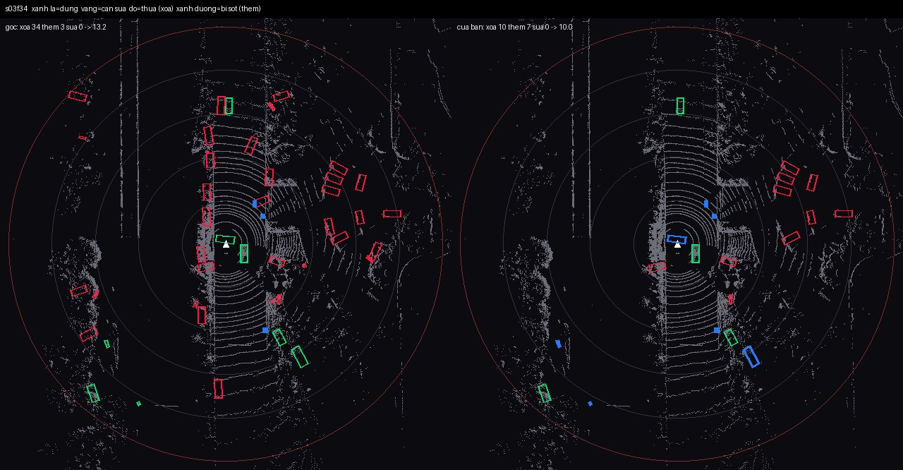

# Báo cáo Day 14 — Nguyễn Duy Khánh — 2A202603055

- Mã học viên dùng với `--student`: `2A202603055`
- `seed_tag` trong `frames_A.txt`: `393590736f`

## 1. Dự đoán trước sweep (bước 5b)

Ghi **trước** khi chạy `scripts/pp_sweep.py`, rồi commit và push ngay (lịch sử commit là bằng chứng thời điểm viết). Không sửa phần này sau khi có kết quả.

- Tham số tôi nghĩ giảm công sửa nhiều nhất: tăng `score_thr` lên 0.5, kèm `min_points=5`.
- Vì sao: cấu hình gốc tốn 24,6, phần lớn do xoá (xóa 62, thêm 5, sửa 2). Trung vị score của 62 hộp tôi xoá là 0,37, còn của 29 hộp giữ lại là 0,74, nên ngưỡng 0.5 nằm giữa hai nhóm: ngưỡng thấp vẫn giữ các hộp ở xa, thưa điểm; ngưỡng quá cao lại lọc mất vật thật (mỗi vật sót tốn 1,0). `score_thr` có thể không bỏ được nhóm hàng rào, bụi cây có score cao; `min_points=5` để bỏ thêm hộp quá ít điểm.

## 2. Tập A: sửa tay và tune

| Cấu hình | Xóa | Thêm | Sửa | Chi phí |
|---|---:|---:|---:|---:|
| Gốc (`score_thr=0.1`, `min_points=0`) | 62 | 5 | 2 | 24.6 |
| `best_config.json` (`score_thr=0.4`, `min_points=5`) | 25 | 12 | 2 | 20.5 |
| Thấp nhất trong sweep (`score_thr=0.5`, `min_points=0`) | 10 | 15 | 2 | 19.0 |

- Tham số đã đổi trong `best_config.json`: `score_thr` 0.1 → 0.4; `min_points` 0 → 5.
- Kết quả leave-one-out (dán các dòng `scripts/pp_sweep.py` in ra):
  ```
  s03f34: cấu hình chọn {'score_thr': '0.5', 'min_points': '0'} → 9.2 (tốt nhất có thể 9.2)
  s04f53: cấu hình chọn {'score_thr': '0.5', 'min_points': '0'} → 4.3 (tốt nhất có thể 3.9)
  s05f36: cấu hình chọn {'score_thr': '0.5', 'min_points': '0'} → 5.5 (tốt nhất có thể 5.5)
  ```
- Cấu hình có ổn định trên từng frame không? Vì sao tôi vẫn chọn (hoặc không chọn) nó: Leave-one-out lần nào cũng chọn 0.5 / 0 và sát mức tốt nhất, nên trên 3 frame này lựa chọn khá ổn định. Tôi vẫn chọn 0.4 / 5 để bớt bỏ sót vật: số "thêm" giảm từ 15 xuống 12, đổi lại chi phí cao hơn 1,5 (20,5 so với 19,0).

## 3. Trước/sau (bước 8)



- `scripts/pp_compare.py` báo giảm 17% công sửa trên tập A (24.6 → 20.5; s03f34 13.2 → 10.0, s04f53 4.8 → 4.6, s05f36 6.6 → 5.9).
- Dự đoán ở mục 1 đúng hay sai? Giải thích bằng số box xóa/thêm/sửa: Dự đoán của tôi đúng một phần: trên tập A, `score_thr` là tham số tác động chính (gốc 24,6 → 19,0 ở 0.5), còn `min_points` gần như không có tác dụng (ở 0.5, cả 0/5/10 đều 19,0). Phần lớn chi phí giảm nhờ xoá ít đi (62 → 10), đổi lại số thêm tăng (5 → 15). Trên tập B, cấu hình 0.4 / 5 giảm xoá từ 230 xuống 70 và chi phí từ 92,0 xuống 44,5. Cần tune trên nhiều frame hơn thì dự đoán mới chính xác.

## 4. Tập B

Số đo từ `scripts/pp_prelabel.py --frames d14_2A202603055/frames_B.txt --config d14_2A202603055/best_config.json --gt d14_2A202603055/ref_B.json`:

| Xóa | Thêm | Sửa | Chi phí |
|---:|---:|---:|---:|
| 70 | 10 | 27 | 44.5 |

Đối chiếu thêm (cùng `ref_B.json`, cấu hình gốc không `--config`): xóa 230, thêm 9, sửa 28 → chi phí 92.0. 12 frame, GT 167 box trong 50 m; dự đoán 227 box (gốc: 388).

- Loại box tốn công sửa nhất ở tập B: hay gặp nhất là thiếu box Bus/Truck và Pedestrian; còn Car bị gán nhầm vào hàng rào, cây, cọc phân cách làn đường, và Cyclist bị gán nhầm vào cọc.

## 5. Giới hạn

- Nêu ít nhất 2 giới hạn (ví dụ: chỉ 3 frame tune; model KITTI không có Truck/Bus; chi phí là công thức, chưa phải thời gian sửa thật): (1) Chỉ có 3 frame để tune nên `best_config` chưa chắc tối ưu; gặp cảnh lạ có thể gán kém. (2) Chi phí là công thức tạm (0,3·xoá + 1·thêm + 0,5·sửa), chưa phải thời gian sửa thật. (3) Model học trên KITTI nên không có lớp Truck/Bus và hay sót Pedestrian.

## Ghi chú công cụ

- Ngoài pre-label của lab, tôi dùng một userscript tự viết trên CVAT local (D14 Sweep Viewer) chỉ để xem số sweep và đếm số hộp đã xoá/thêm/sửa khi đang sửa; công cụ chỉ đọc, không tạo hay sửa nhãn.
- Dùng Claude để hỏi lệnh, giải thích tham số, điền các bảng số từ output của script và sửa câu chữ báo cáo. Dự đoán 5b, lựa chọn cấu hình và kết luận đối chiếu do tôi tự quyết.
